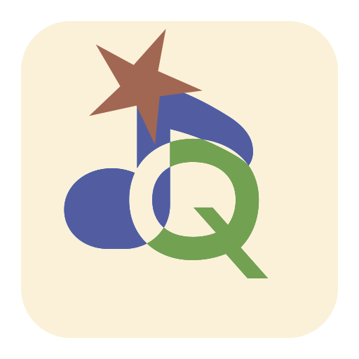
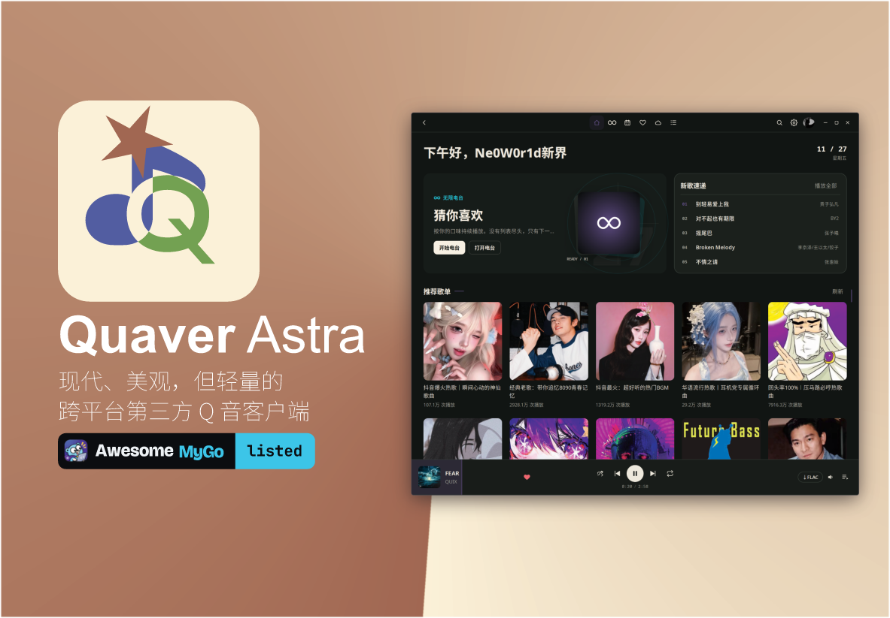
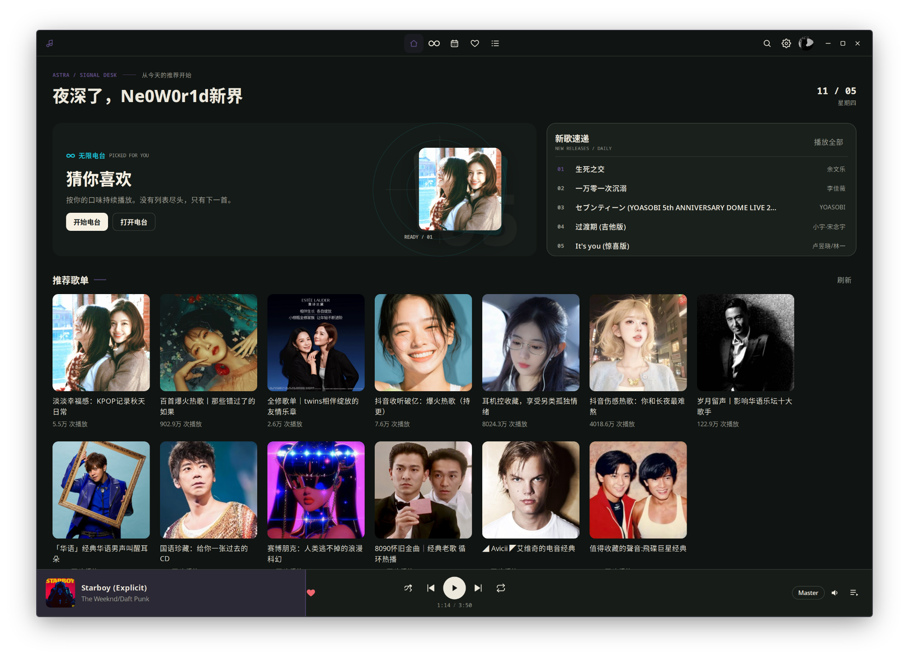

<p align="center">
  
</p>

# Quaver Music Astra

现代、美观的跨平台第三方 Q 音客户端，现已轻装上阵

[](https://awesomemygo.dev/apps/quaver-astra)

<p align="center">
  
</p>

Quaver （Music） Astra，是一个基于 MyGO 的，使 Quaver Music 轻量化为目的的第三方 QQ 音乐客户端。以复用 Typhoeus Golang 后端，而非重复造轮子

Astra 名字取自《绝区零》角色耀嘉音（Astra Yao ），也可以是《无畏契约》角色星礈（Astra ），由于想名想了半天，这个名字容易冲突，且能代表星星闪耀

- **UI**：[MyGo](https://github.com/egoist/mygo) 的原生 UI 工具包（`ui` 包）——视图是状态的函数，由 MyGo 在 GPU 上直接绘制（Linux 走 OpenGL），不开 WebKitGTK，窗口秒开、内存占用小。 
- **后端**：[Typhoeus-go](https://github.com/Team-Quaver/typhoeus-go)（子模块 `third_party/Typhoeus-go`）**进程内嵌**——不再是 sidecar 独立进程，`quaver-server` 的完整路由表直接挂在本进程 `127.0.0.1` 的随机端口上。
- **音频后端**：[Liino](https://github.com/Team-Quaver/liino)（子模块 `third_party/Liino`）**进程内嵌**，使用其 Native 模式：在 Astra 进程内完成解码 → DSP → 缓冲 → 系统输出，不启动 mpv 子进程。Linux 走 `decode/native`（ffgo 动态加载系统 FFmpeg）并输出到 PipeWire，Windows 优先 WinRT（MediaSource/AudioGraph）+ WASAPI（WMF/ffgo 兜底），macOS 优先 AVFoundation + Core Audio。macOS 上 Liino 为**实验性**后端；可在设置 → 播放关闭 **「使用 MPV 作为播放后端」** 切回 Liino。mpv 按本地/随包/PATH 三级定位，保留其缓存与断流重连能力，切换立即生效。Linux 的 Liino 模式支持 **PipeWire 自适应采样率**（设置 → 播放）：可让解码、DSP 与输出跟随曲目采样率，并可选择让 PipeWire 同步切换 `node.rate` 硬件时钟；修改在下一首生效。
- **淡入淡出**：设置 → 播放提供 `0s / 0.15s / 0.4s / 0.8s` 四档（配置键 `Playing.Fade`），MPV 与 Liino 共用同一套输出侧振幅包络：起播淡入，切歌、暂停与停止先淡出；`0s` 档是真正的硬切。

> [!CAUTION]
> 真爱音乐，尊重正版，音乐平台不易，该应用**不提供盗版 QQ 音乐曲目服务！**

## 构建与运行

依赖：

- Go 1.27+（Linux 需 GTK3）
- **Liino 运行库**（播放必需）：
  - Linux：系统 FFmpeg 共享库（`libavformat` / `libavcodec` / `libavutil` / `libswresample`，装 `ffmpeg` 或发行版的 `ffmpeg-libs` 即可）与 PipeWire。设置 → 关于页会显示解码后端/输出驱动的自检结果。
  - Windows：WinRT `Windows.Media.Core` / `AudioGraph` + WASAPI（Windows N 版需 Media Feature Pack）；Ogg/Opus 依赖 Microsoft Store 的「Web Media Extensions」，WinRT 打不开时回退 WMF，容器仍不支持再回退系统 FFmpeg DLL。
  - macOS：AVFoundation + Core Audio；同样在需要时回退系统 FFmpeg 动态库。

```sh
git clone --recurse-submodules https://github.com/Team-Quaver/quaver-astra
cd quaver-astra
go build .
./quaver-astra
```

Windows 的图标与版本信息资源在 CI 里由
[go-winres](https://github.com/tc-hib/go-winres) 从 `winres/` 现场生成
（macOS 的 icns 同样在打包脚本里从 `img/app-icon.png` 现场缩放生成）。
本地构建 Windows 版想带图标时执行一次：
`go install github.com/tc-hib/go-winres@v0.3.3 && go-winres make --in winres/winres.json --out rsrc --arch amd64,arm64`。

测试：

```sh
go test ./internal/...
```


自检钩子（开发用）：

- `QUAVER_ROUTE=<path>` 启动后导航到指定路由
- `QUAVER_SCREENSHOT=<png>` + `QUAVER_SCREENSHOT_DELAY=<秒>` 延时截图后退出
- `QUAVER_PLAY_FIRST=1` 自动播一首新歌（验证播放链路）
- `QUAVER_CONFIG_DIR=<dir>` 自定义配置目录
- `XDG_CACHE_HOME=<dir>`（Linux）改变默认音乐缓存位置；用户自定义位置存在配置里的 `Playing.LocalCacheDir`，不读 `QUAVER_CACHE_DIR`（那个变量在内嵌后端眼里等于「平台默认」，写进去会让设置页的「恢复默认」失效）

## 与主项目（Quaver Music）的差异

Astra 缺少以下内容：本地音乐。

## 许可

AGPL-3.0-Only（见 [LICENSE](LICENSE)）。第三方依赖见 go.mod；MyGo（MIT）、Typhoeus-go、Liino（AGPL-3.0，子模块）、jixunmoe-go/qrc（MIT，QRC 本地兜底解码）。
